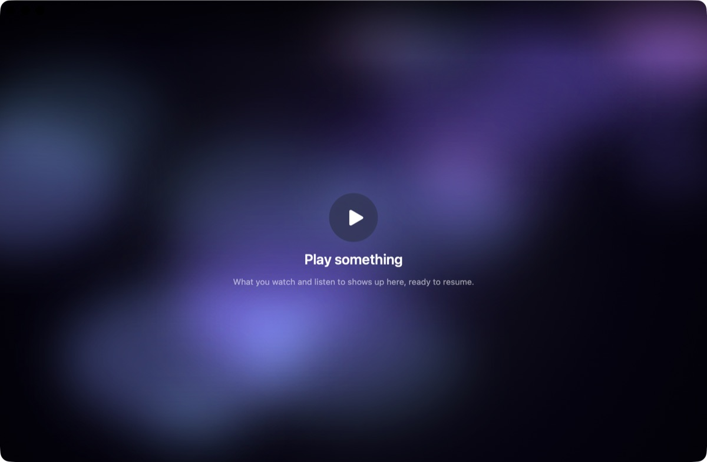
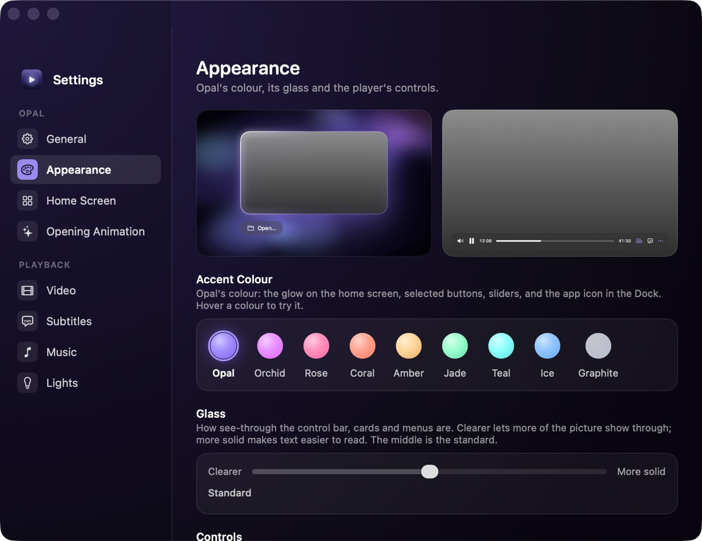

<h1 align="center">Opal</h1>

A Liquid Glass video and music player for macOS.

A Liquid Glass video and music player for macOS. Plays everything (MKV, AV1, WebM),
with subtitles, casting, and an album-art music mode.

Screenshots show a fresh install with empty and settings screens; no real files or accounts.

## Install

1. Download **Opal-x.y.z.dmg** from the [latest release](https://github.com/SamDeHerdt/Opal/releases/latest).
2. Open it and drag **Opal** onto **Applications**.
3. The first time you open it, macOS may warn that it's from an unidentified developer.
   It isn't signed with a paid Apple Developer account. Fix this once by either:
   - right-clicking Opal in Applications → **Open** → **Open**, or
   - running `xattr -dr com.apple.quarantine /Applications/Opal.app` in Terminal.

## Updates

Opal checks for new versions and offers to install them. Updates are signed and verified
before they're installed. What changed in each version is in [CHANGELOG.md](CHANGELOG.md).

## Issues

Found a bug? [Open an issue](https://github.com/SamDeHerdt/Opal/issues). This repository
holds the downloads and the update feed; the source code is not public.
